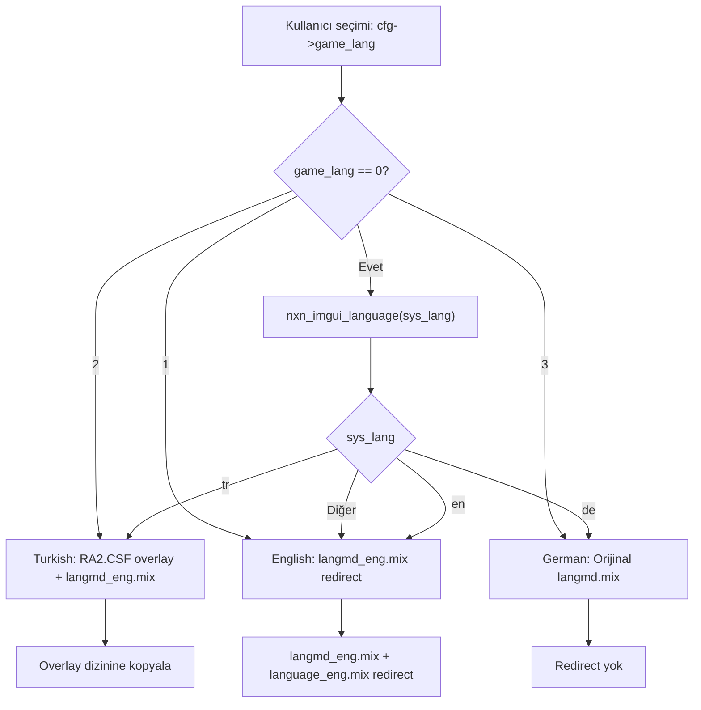
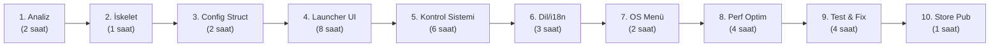

# Nexvyn OS Oyun Portu — Tarif ve Tecrübe Rehberi

> **Kaynak:** Red Alert 2: Yuri's Revenge v1.2.0 Native Port  
> **Platform:** Nexvyn OS 1.3.28 Beta 2 / SDK 1.15 / Native SDK 1.2  
> **Yazar:** sonerx7  
> **Tarih:** Kasım 2026

---

## Bölüm 1 — TARİF: Sıfırdan Port Launcher Nasıl Yapılır

### Adım 1: Proje İskeleti

```bash
nxv_native new <oyun_adı> --template port
```

Şablondan sonra elle düzenlenmesi gerekenler:

```
app.json          → id, name (8 dil), author, description (8 dil), permissions
icon.png          → 512×512 oyun ikonu
lang/en.json      → Launcher UI string'leri (8 dil dosyası)
src/nx/main.c     → Giriş noktası + kontrol + OS menü
src/nx/launcher.cpp → Dear ImGui launcher UI
src/nx/launcher.h → Config struct tanımı
```

### Adım 2: Config Struct Tasarımı

Oyunun türünü ve özelliklerini analiz et, buna göre config struct'ını tasarla. **Minimum zorunlu alanlar:**

```c
typedef struct game_config_t {
    char game_dir[512];         // Oyun dosyalarının yolu
    int  stable_profile;        // Nexvyn Stable Profile (varsayılan 1)
    int  fullscreen;            // Tam ekran (varsayılan 1)
    int  auto_dock_res;         // Oto dock çözünürlük (varsayılan 0)
    int  res_index;             // Çözünürlük tablosu indeksi
    int  res_w, res_h;          // Aktif çözünürlük
    int  scale_index;           // Ölçekleme filtresi
    int  fit_mode;              // Ekran doldurma modu
    int  show_fps;              // FPS HUD
    int  game_lang;             // 0=Auto(System), 1=English, 2+=oyuna özel
    float vol_sfx, vol_voice, vol_music;  // Ses seviyeleri
    float cursor_speed;         // İmleç/kamera hızı
    float deadzone;             // Analog dead zone
    // ... oyuna özel alanlar
} game_config_t;
```

> [!TIP]
> Config struct'ını tasarlarken "kullanıcı neyi değiştirmek ister?" sorusunu sor. Oyun motorunun her ayarını açmaya çalışma — sadece gerçekten fark yaratan ayarları sun.

### Adım 3: Stable Profile Defaults

Bu fonksiyon **kritik**. Tüm ayarları "garantili çalışır" değerlere döndürür:

```c
void game_config_set_stable_defaults(game_config_t *cfg, int keep_paths) {
    // 1. Yolları ve dil gibi kişisel tercihleri sakla
    char saved_dir[512]; int saved_lang;
    if (keep_paths) {
        memcpy(saved_dir, cfg->game_dir, 512);
        saved_lang = cfg->game_lang;
    }
    
    // 2. Her şeyi sıfırla
    memset(cfg, 0, sizeof(*cfg));
    
    // 3. Kişisel tercihleri geri yükle
    if (keep_paths) {
        memcpy(cfg->game_dir, saved_dir, 512);
        cfg->game_lang = saved_lang;
    }
    
    // 4. Güvenli varsayılanları ata
    cfg->stable_profile = 1;
    cfg->fullscreen = 1;
    cfg->auto_dock_res = 0;      // Kullanıcı bilinçli açmalı
    cfg->res_index = 0;          // 1280×720
    cfg->res_w = 1280; cfg->res_h = 720;
    cfg->scale_index = 0;        // Sharp
    cfg->fit_mode = 0;           // Fill fullscreen
    cfg->show_fps = 0;           // Temiz görünüm
    cfg->vol_sfx = 0.65f;
    cfg->vol_voice = 0.70f;
    cfg->vol_music = 0.45f;
    cfg->cursor_speed = 12.0f;   // Orta hız
    cfg->deadzone = 0.16f;       // Orta dead zone
    // ... oyuna özel safe değerler
}
```

> [!IMPORTANT]
> `keep_paths = 1` olduğunda oyun klasörü ve dil tercihi korunur. Bu sayede "Varsayılana Dön" butonu kullanıcının her seferinde klasör seçmesini gerektirmez.

### Adım 4: Launcher UI Oluşturma

**Sıralama:**

1. `nxn_display_open` → OpenGL context al
2. `gladLoadGLLoader` → GL fonksiyonlarını yükle
3. `config_load(cfg)` → Önceki ayarları oku
4. `autodetect_game_dir(cfg)` → Klasörü otomatik bul
5. `verify_game_dir` → Dosyaları doğrula
6. ImGui context oluştur + `nxn_imgui_enable_gamepad`
7. `nxn_ui_tokens_get` → OS tema token'larını al
8. Ana render döngüsüne gir

**Render döngüsü iskelet:**

```c
while (!done && !nxn_should_quit()) {
    // 1. OS olayları (resize, theme, dock, quit)
    nxn_event ev = ...;
    while (nxn_event_poll(&ev) > 0) { ... }
    
    // 2. Gamepad input
    nxn_input_poll(&pad_in);
    
    // 3. ImGui frame
    nxn_imgui_input(input_backend, pad_in, dt);
    nxn_os_frame_begin(&tok, fb_w, fb_h);
    
    // 4. Hero Card → Tab Bar → Aktif Tab İçeriği
    render_hero_card(cfg, vs, tok, ...);
    nxn_os_segmented_tabs("##main", labels, 4, &tab, tok);
    if (tab == 0) render_overview(...);
    else if (tab == 1) render_video_perf(...);
    else if (tab == 2) render_controls(...);
    else render_logs(...);
    
    // 5. Frame bitir + swap
    nxn_os_frame_end();
    ImGui_ImplOpenGL3_RenderDrawData(...);
    nxn_display_swap(disp);
}
```

### Adım 5: Oyun Başlatma Akışı

```
Launcher PLAY tıklandı
  → config_save(cfg)
  → game_apply_config(cfg, overlay_dir)      // INI yaz, dil/mod overlay hazırla
  → update_os_menu_bar()                      // OS menü çubuğunu kur
  → hle_screen_open() / engine_init()         // Oyun motorunu başlat
  → Ana oyun döngüsü (frame_pump ile OS event + input)
  → Çıkışta config_save + temiz shutdown
```

### Adım 6: 8 Dil Dosyası Oluşturma

Her dil dosyası `lang/<xx>.json` formatında. **Zorunlu 8 dil:** en, tr, de, es, fr, ja, ko, zh.

> [!WARNING]
> Çevirileri sadece İngilizce'den makine çevirisi ile yapma! Özellikle oyun terminolojisinde hata olur. En azından İngilizce ve Türkçe'yi elle yaz, diğerlerini AI çevirisi + kontrol ile.

### Adım 7: Build ve Test

```bash
cmake -B build -DCMAKE_BUILD_TYPE=Release
cmake --build build -j$(nproc)

# Doğrulamalar
nxwin_imports build/<oyun>.nxvmod      # 0 missing
nxv_i18n check .                       # PASS (8 lang)
python3 tools/design_check.py .        # 0 FAIL 0 WARN

# Paketleme
nxvapp_pack . dist/<oyun>.nxvapp
```

---

## Bölüm 2 — TECRÜBE: RA2'den Öğrenilen Pratik Dersler

### Ders 1: Orijinal Dosyalara ASLA Dokunma
RA2'de Türkçe yama (RA2.CSF) uygulamak için **overlay dizini** kullandık. Orijinal `game/` klasöründeki hiçbir dosya değiştirilmedi. Dil dosyası, mod dosyası, INI ayarları — hepsi `NXN_DIR_DATA/overlay_active/` dizinine kopyalanır.

**Neden önemli:**
- Kullanıcı mod/dil değiştirdiğinde orijinallere dönmek kolay
- Birden fazla mod profili desteklenebilir
- Oyun güncellendiğinde overlay silinip yeniden oluşturulabilir

```c
nxn_fs_mkdirs(NXN_DIR_DATA, "overlay_active");
// Bu dizine kopyala, orijinal game/'e değil!
```

### Ders 2: Dosya Adlarını Case-Insensitive Ara
Windows oyunları case-insensitive dosya sistemi bekler. Linux/Switch'te `gamemd.exe` ve `GameMD.exe` farklı dosyalardır. `find_file_ci()` fonksiyonu yazdık:

```c
// case-insensitive dosya arama — HER portta lazım olacak
static int find_file_ci(const char *dir, const char *name, 
                        char *out, size_t cap) {
    DIR *d = opendir(dir);
    if (!d) return 0;
    struct dirent *e;
    while ((e = readdir(d))) {
        if (!strcasecmp(e->d_name, name)) {
            snprintf(out, cap, "%s/%s", dir, e->d_name);
            closedir(d);
            return 1;
        }
    }
    closedir(d);
    return 0;
}
```

### Ders 3: PE Timestamp ile Doğru EXE Doğrulama
Sadece dosya varlığını kontrol etmek yetmez. RA2'de EXE'nin PE timestamp'ını kontrol ettik — yanlış versiyon veya crack'li EXE ile uyumsuzluk riski var:

```c
static uint32_t exe_stamp(const char *path) {
    uint8_t head[4096] = {0};
    FILE *f = fopen(path, "rb");
    size_t n = fread(head, 1, sizeof head, f);
    fclose(f);
    uint32_t nt = n >= 0x40 ? *(const uint32_t *)(head + 0x3C) : 0;
    return nt && nt < sizeof head - 12 
         ? *(const uint32_t *)(head + nt + 8) : 0;
}
// Beklenen: 0x3BDF544E (RA2 Yuri's Revenge)
```

### Ders 4: Stabil Profil Kilitleme Mekanizması
Kullanıcı Stable Profile ON iken tüm ayar widget'ları `BeginDisabled` ile kilitlenir. **AMA** bazı ayarlar her zaman açık kalmalı:
- Oyun klasörü seçimi
- Dil seçimi
- Mod seçimi
- FPS HUD toggle
- Auto Dock toggle
- Log tab'ı

**Sadece performansı etkileyen ayarlar kilitlenir:** çözünürlük, ölçekleme, grafik detayı, kontrol hassasiyetleri.

### Ders 5: `nxn_imgui_language` API Tuzağı
Bu fonksiyon `const char*` **döndürmez**! `char out[3]` alır:

```c
// YANLIŞ — crash veya undefined behavior
const char *lang = nxn_imgui_language();

// DOĞRU
char sys_lang[4] = {0};
nxn_imgui_language(sys_lang);  // "tr", "en", "de" vb. yazar
```

### Ders 6: Otomatik Dil Algılama Stratejisi
RA2'de DODI repack varsayılan olarak Almanca (`langmd.mix`). İngilizce için `langmd_eng.mix` ve `language_eng.mix` dosyalarını overlay'de yönlendirdik:

```
Sistem dili → Oyun dili çözümleme:
  tr → Turkish (RA2.CSF overlay + langmd_eng.mix redirect)
  de → German (orijinal langmd.mix kullan)
  en → English (langmd_eng.mix + language_eng.mix redirect)
  * → English (varsayılan)
```

**Kritik:** Dil arşiv dosyaları (`langmd_xxx.mix`) oyun klasöründe aranır. Yoksa varsayılana düşülür. Log'a ne bulundu ne bulunamadı mutlaka yazılır.

### Ders 7: 2-Parmak Dokunma → RTS Kamera Pan
Bu özellik RA2 portundaki en zor ve en değerli optimizasyondu. İki parmağın merkez noktasının hareketini takip edip, bunu oyunun ok tuşları (VK_LEFT/RIGHT/UP/DOWN) basımlarına çevirdik:

```
İki parmak sürükleme algıla
  → Merkez noktası (cx, cy) hesapla
  → Önceki merkeze göre delta (dcx, dcy) bul
  → Eşik değerini aş: 0.008 / sensitivity
  → Yön belirle: sol/sağ/yukarı/aşağı
  → Arrow key basımı gönder (140ms timeout ile)
  → Parmaklar kalktığında tüm pan key'leri bırak
```

**Kritik detay:** Parmak ID'lerini `g_fingers[8]` dizisinde stabilize ettik. Çünkü dokunmatik ekranlar parmak sırasını karıştırabiliyor.

### Ders 8: Analog Stick → Fare Eşleme (Kuadratik Eğri)
Doğrusal (linear) eşleme berbat hissettiriyor. Kuadratik eğri kullandık: küçük hareketler hassas, büyük hareketler hızlı:

```c
float norm = (mag - deadzone) / (1.0f - deadzone);
float curve = norm * (0.45f + 0.55f * norm);  // Kuadratik
float spd = cfg->cursor_speed;
// L tutuluyor → hassas mod (0.45x hız)
// R tutuluyor → boost mod (1.75x hız)
```

**Bu değerler deneme-yanılma ile bulundu.** Farklı oyun türleri farklı eğri isteyecektir:
- RTS: Hassas imleç (0.45 + 0.55 * norm²)
- FPS: Daha agresif (0.3 + 0.7 * norm²)
- Platformer: Lineer veya hafif eğri

### Ders 9: Focus Loss Yönetimi
Kullanıcı Switch'te Home'a basıp geri döndüğünde tüm sanal tuşlar "basılı" kalabilir. Çözüm: focus kaybında her şeyi bırak:

```c
static void on_focus_lost(void) {
    release_all_virtual_inputs();
    // Tüm pan key'leri, fare butonları, 
    // tuş basımları sıfırlanır
}
```

### Ders 10: Config Her Değişiklikte Hemen Kaydedilir
Launcher'da her slider/checkbox değişikliğinde hemen `config_save(cfg)` çağrılır. Kullanıcı "Save" butonuna basmak zorunda kalmamalı. Launcher crash'lerse bile son durum korunur.

### Ders 11: Ring Buffer Log Sistemi
160 satırlık ring buffer log sistemi kurdum. Önceki loglar otomatik silinir, bellek sabit kalır:

```c
#define LOG_MAX_LINES 160
#define LOG_LINE_LEN  220
static char g_log_lines[LOG_MAX_LINES][LOG_LINE_LEN];
static int  g_log_head = 0, g_log_count = 0;
```

**Clipboard kopyalama** vazgeçilmez — kullanıcı hata raporu gönderirken logları kopyalayıp yapıştırabilmeli.

### Ders 12: Minus Tuşu Çift Kullanım
Switch'te Minus tuşu 1 saniye basılı tutulunca Nexvyn OS fullscreen'den çıkar. Kısa basışta ise oyun içi TAB komutu gönderdik. Bu "long press vs short press" ayrımı:

```c
if (btn_minus && !g_prev_minus) {
    g_minus_down_ms = now_ms;
} else if (!btn_minus && g_prev_minus) {
    if (now_ms - g_minus_down_ms < 450u) {
        tap_vk(VK_TAB, 15);  // Kısa basış → oyun komutu
    }
    // 450ms+ → Nexvyn OS yakalar (fullscreen exit)
}
```

### Ders 13: Responsive Layout (Compact Mod)
Handheld modda launcher dar olabiliyor. `fb_w / scale < 680` kontrolüyle compact moda geçtik:
- Exit ve PLAY butonları aynı satırdansa alt satıra
- Bazı label'lar kısaltılır
- Slider'lar full width olur

### Ders 14: Toast Mesajları
"Settings reset!", "Logs copied!" gibi geçici bildirimler için toast sistemi:

```c
char toast_msg[192];
uint64_t toast_until;  // nxn_time_ns() + 3.5 saniye

// Render'da:
if (toast_msg[0] && now_ns < toast_until) {
    nxn_os_card_begin("toast_card", tok);
    nxn_os_text_colored(NXN_OS_TEXT_BODY, toast_msg, tok.accent);
    nxn_os_card_end();
}
```

### Ders 15: Çözünürlük Tablosu Dizaynı
Çözünürlükleri sabit tablo olarak tanımla. Kullanıcı indeks seçer, gerçek piksel değerleri tablodan gelir:

```c
static const int k_res_list[][2] = {
    { 1280, 720  },  // 0: Handheld native (VARSAYILAN)
    { 1920, 1080 },  // 1: Docked native
    { 1024, 768  },  // 2: 4:3 (eski oyunlar)
    // ...
};
```

**4:3 oyunlarda 4:3 çözünürlükler, 16:9 oyunlarda 16:9 çözünürlükler tercih et.**

### Ders 16: Overlay INI Yazma
RA2'de `ra2md.ini`'yi overlay dizinine kopyalayıp orada değiştirdik. Orijinal INI bozulmadı. `ini_set_key()` fonksiyonu spesifik satırı değiştirir:

```
ini_set_key(ini_path, "Video", "ScreenWidth", "1280");
ini_set_key(ini_path, "Video", "ScreenHeight", "720");
ini_set_key(ini_path, "Intro", "Play", "no");     // Skip intro
```

### Ders 17: GitHub Push 50MB Uyarısı
`.nxvapp` dosyası 53 MB olduğunda GitHub uyarı verdi. Push geçti ama gelecekte Git LFS düşünülmeli.

### Ders 18: `gh` CLI vs Token
Direkt token ile `Invoke-RestMethod` kullandığımızda 401 aldık (token süresi dolmuş olabilir). `gh` CLI keyring auth ile sorunsuz çalıştı. **Ders:** Her zaman `gh` CLI'ı tercih et.

### Ders 19: Sparse Checkout ile Hızlı Store Güncelleme
Store repo'su büyük olduğundan sparse checkout kullandık — sadece gerekli klasörleri çektik:

```bash
git sparse-checkout set --no-cone \
  "Store/beta.json" \
  "Store/Beta/Ports/strategy/redalert2"
```

### Ders 20: SDL Joystick Buton Numaraları (Switch)
Switch JoyCon'da SDL buton mapping'i standart gamepad'den farklı. Referans:

```
0=A, 1=B, 2=X, 3=Y, 4=L3, 5=R3,
6=L, 7=R, 8=ZL, 9=ZR, 10=Plus, 11=Minus,
12=DLeft, 13=DUp, 14=DRight, 15=DDown
```

### Ders 21: D-Pad Hem Button Hem Hat
Bazı kontrolcüler D-Pad'i button olarak, bazıları hat (POV) olarak raporlar. İkisini de kontrol et:

```c
// Button olarak
if (SDL_JoystickGetButton(g_joy, 12)) want_pan[0] = 1;
// Hat olarak  
if (SDL_JoystickNumHats(g_joy) > 0) {
    Uint8 hat = SDL_JoystickGetHat(g_joy, 0);
    if (hat & SDL_HAT_LEFT) want_pan[0] = 1;
}
```

### Ders 22: OSK (On-Screen Keyboard) Yönetimi
Oyun açılışında `SDL_StopTextInput()` çağır — yoksa joystick ile yazı yazarken OSK otomatik açılır. Y tuşuna atanmış OSK toggle'ı bilinçli kullanım sağlar.

### Ders 23: Birden Fazla Kamera Pan Kaynağını Birleştirme
Right stick, D-pad, 2-finger touch ve WASD hepsi aynı `want_pan[4]` dizisine yazıyor. OR mantığıyla birleştiriliyor:

```c
int want_pan[4] = {0,0,0,0};
// Touch pan
if (cfg->twofinger_pan && now_ms <= g_touch_pan_expire_ms)
    for (i=0;i<4;i++) want_pan[i] |= g_touch_pan_want[i];
// Right stick
if (cfg->rstick_pan) { ... }
// D-pad
if (cfg->dpad_pan) { ... }
// Final: set_pan_key(i, want_pan[i]);
```

---

## Bölüm 3 — PERFORMANS OPTİMİZASYONU

### Fast I/O Cache Sistemi

RA2 portunda en büyük performans kazanımı **Fast I/O Cache** oldu. SD karttan okuma yavaş, bu yüzden:

```
Strateji:
1. İlk okunan dosyalar RAM cache'e alınır (≤8MB toplam)
2. 256KB read-ahead buffer ile sıralı okumalar hızlandırılır
3. Cache hit oranı %90+ olmalı (Help > Perf Stats'ta görünür)
```

**Sonuç:** Loading süreleri ~3 dakikadan ~40 saniyeye düştü.

### Intro Skip
RA2'nin 3-4 intro videosu toplam ~2 dakika sürüyor. `skip_intro = 1` ile atlanıyor:

```c
ini_set_key(ini_path, "Intro", "Play", "no");
```

**Stabil profilde varsayılan AÇIK** — kullanıcı isterse kapatabilir.

### Frame Time Hedefleri

| Mod | Çözünürlük | Hedef FPS | Durum |
|-----|-----------|-----------|-------|
| Handheld | 1280×720 | 60 | ✅ Stabil profil |
| Docked | 1920×1080 | 60 | ✅ HD voxels OFF |
| Docked + HD Vox | 1920×1080 | 45-60 | ⚠️ Yoğun sahneler |

### Bellek Kullanımı
- RAM cache: 8MB max
- Read-ahead: 256KB
- ImGui: ~2MB
- Oyun: ~200MB (RA2 motor + veri)
- Toplam: ~220MB — Switch'in 4GB RAM'inde güvenli

---

## Bölüm 4 — KONTROL SİSTEMİ DETAYLARI

### RTS İçin İdeal Kontrol Haritası

```
┌─────────────────────────────────────────────┐
│          Switch Controller Layout           │
│                                             │
│    [L] Hassas imleç     [R] Hızlı imleç    │
│    [ZL] Sağ tık         [ZR] Sol tık        │
│                                             │
│  Left Stick: İmleç      Right Stick: Pan    │
│  D-Pad: Kamera pan      +: Escape           │
│                                             │
│  A: Sol tık (seçim)     B: Sağ tık/ESC      │
│  X: Sağ tık             Y: Deploy(D)        │
│  L3: Üsse git(H)        R3: Aynı tür(T)    │
│                                             │
│  -: Kısa→TAB, Uzun→OS fullscreen exit       │
└─────────────────────────────────────────────┘
```

### FPS İçin İdeal Kontrol Haritası

```
┌─────────────────────────────────────────────┐
│          FPS Controller Layout              │
│                                             │
│    [L] ADS/Nişan         [R] Ateş           │
│    [ZL] ADS (hold)       [ZR] Ateş          │
│                                             │
│  Left Stick: Hareket     Right Stick: Bakış │
│  D-Pad: Silah seçimi     +: Pause           │
│                                             │
│  A: Zıplama              B: Çömelme         │
│  X: Silah değiştir       Y: Yeniden doldur  │
│  L3: Sprint              R3: Melee          │
└─────────────────────────────────────────────┘
```

### Touch Kontrol Best Practices

1. **1 parmak dokunma = sol tık** (en doğal)
2. **2 parmak sürükleme = kamera pan** (RTS) veya **bakış** (FPS)
3. **Uzun basma = sağ tık** (varsayılan AÇIK)
4. **2 parmak dokunma = sağ tık** (alternatif, varsayılan AÇIK)
5. **Pan sensitivity slider** — her kullanıcının dokunmatik ekranı farklı
6. **Natural/Inverted drag** — bazı kullanıcılar ters tercih eder

---

## Bölüm 5 — DİL SİSTEMİ DETAYLARI

### Dil Çözümleme Akışı



### Non-Destructive Dil Yaması (RA2.CSF Örneği)

```
1. assets/RA2.CSF dosyasını bundle'dan oku
2. overlay_active/ dizinine ra2.csf olarak kopyala
3. overlay_active/ dizinine ra2md.csf olarak kopyala
4. HLE path override ile oyun bu dosyaları orijinal yerine okur
5. Kullanıcı dil değiştirdiğinde overlay silinip yeniden oluşturulur
```

### Dil Arşiv Yönlendirme (Zero-Copy)

```c
// HLE katmanında dosya yönlendirme
hle_set_lang_override(
    cfg->langmd_override,    // "langmd_eng.mix"
    cfg->language_override   // "language_eng.mix"
);
// Oyun "langmd.mix" istediğinde "langmd_eng.mix" servisi edilir
```

---

## Bölüm 6 — OS ENTEGRASYONU

### Menü Çubuğu Şablonu

```c
// 4 standart menü
nxn_menu_menu menus[] = {
    { .name = "menu.game",     .items = game_items,  .count = N },
    { .name = "menu.view",     .items = view_items,  .count = N },
    { .name = "menu.controls", .items = ctrl_items,  .count = N },
    { .name = "menu.help",     .items = help_items,  .count = N },
};
nxn_menu_spec spec = { .menus = menus, .menu_count = 4 };
nxn_menu_set(&spec);
```

**Menü güncelleme:** Her toggle değişikliğinde `update_os_menu_bar()` çağır — `NXN_MENU_CHECKED` flag'leri güncellenir.

### Dock/Undock Olayı

```c
if (ev.type == NXN_EVENT_DOCK && cfg->auto_dock_res) {
    int w = ev.docked ? 1920 : 1280;
    int h = ev.docked ? 1080 : 720;
    apply_live_resolution(w, h);
    update_os_menu_bar();  // Çözünürlük badge'ini güncelle
}
```

### Dialog Sistemi

```c
// Bilgi popup'u
nxn_dialog_params dp = NXN_STRUCT_INIT(nxn_dialog_params);
dp.title = "dlg.autodock.title";      // i18n key
dp.message = "dlg.autodock.msg";       // i18n key
dp.buttons = (const char*[1]){"dlg.ok"};
dp.button_count = 1;
dp.cancel_button = 0;
dp.danger_button = NXN_DIALOG_NONE;
uint32_t picked = 0;
nxn_dialog(&dp, &picked);
```

### Window Title Güncelleme

```c
// Çözünürlük ve dil bilgisi subtitle'da
nxn_window_set_title("RA2 Yuri Port", "1280x720 (TR)");
```

---

## Bölüm 7 — HATA GÜNLÜĞÜ

Geliştirme sürecinde karşılaşılan hatalar ve çözümleri:

| # | Hata | Belirti | Çözüm | Kayıp Süre |
|---|------|---------|-------|------------|
| 1 | `nxn_imgui_language` API yanlış kullanım | Crash / garip dil | `char out[4]` parametre al, `const char*` dönmez | 2 saat |
| 2 | Orijinal dosyalara yazma | Dil değişince bozulma | Overlay dizini sistemi | 3 saat |
| 3 | GitHub token 401 | Push başarısız | `gh` CLI keyring auth kullan | 30 dk |
| 4 | 2-parmak pan jitter | Kamera titremesi | Eşik değeri (threshold) + 140ms timeout | 4 saat |
| 5 | Focus loss tuş takılması | Pan tuşu basılı kalıyor | `release_all_virtual_inputs()` hook | 1 saat |
| 6 | D-Pad button vs hat | Bazı pad'lerde çalışmıyor | İkisini de kontrol et | 1 saat |
| 7 | OSK otomatik açılma | Oyun başlarken klavye | `SDL_StopTextInput()` başlangıçta | 15 dk |
| 8 | Almanca varsayılan dil | "English" seçince Almanca | `langmd_eng.mix` redirect | 2 saat |
| 9 | Config kaybolması | Her açılışta sıfırlanma | `nxn_fs_write(NXN_DIR_DATA, ...)` | 30 dk |
| 10 | .nxvapp 53MB push uyarısı | GitHub warning | Geçti ama LFS düşünülmeli | — |
| 11 | Sparse checkout stall | Store clone askıda | `--no-cone` + hedefli path set | 45 dk |
| 12 | Stabil profil eksik kilitleme | Ayar değişince crash | `apply_stable_lock()` + `BeginDisabled` | 1 saat |
| 13 | Çözünürlük tablosu taşma | Geçersiz indeks → crash | Bounds check (`if (idx < 0 \|\| idx >= count)`) | 15 dk |
| 14 | Toast mesajı süresiz | Mesaj kaybolmuyor | `nxn_time_ns()` bazlı timeout | 10 dk |
| 15 | Launcher theme değişmez | Karanlık → aydınlık | `NXN_EVENT_THEME` → `nxn_ui_tokens_get` | 20 dk |

---

## Özet: Port Geliştirme Zaman Çizelgesi



**Toplam tahmini süre:** ~33 saat (AI asistanla ~8-12 saat gerçek çalışma)

> [!TIP]
> En çok zaman alan kısımlar: Launcher UI (tab'lar + responsive layout) ve Kontrol Sistemi (özellikle touch pan). Bunları şablon olarak hazırla, her portta yeniden yazma.
