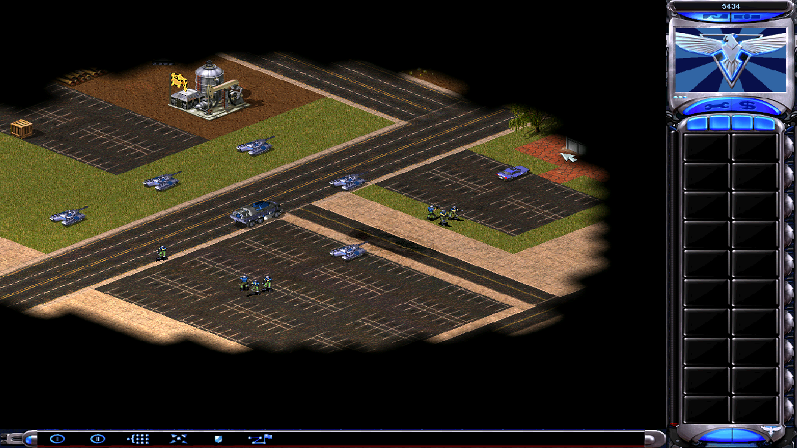
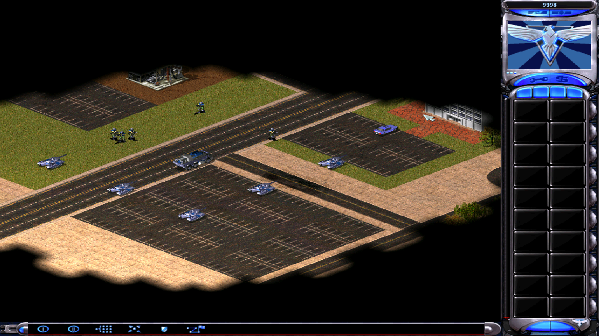
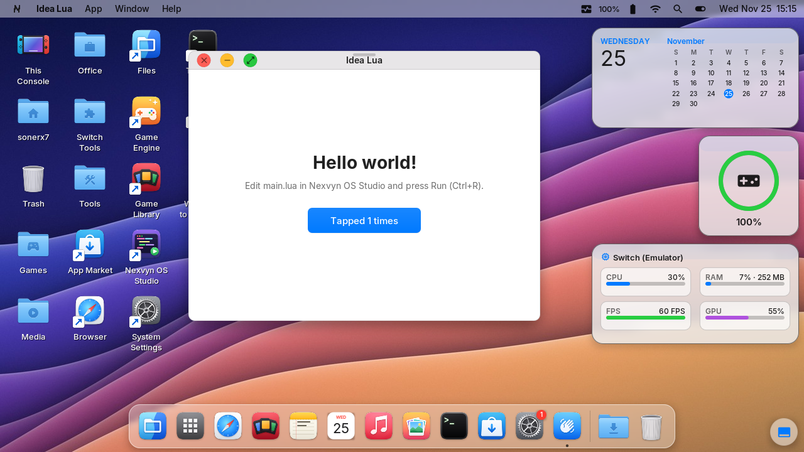

# Nexvyn Port Studio

Nexvyn Port Studio is a workspace and toolchain for bringing existing games and applications to the console as native Nexvyn OS modules, and for starting new apps for it. It covers feasibility assessment, engine and library selection, SDK setup, scaffolding, build, verification, launcher and controls, emulator testing and App Market packaging. It is written for developers and for coding agents (agents start from [AGENTS.md](AGENTS.md)). The public Nexvyn OS SDK ships with the repository.

| Red Alert 2, handheld | Red Alert 2, docked | New Lua app, handheld |
| --- | --- | --- |
|  |  |  |

All images are emulator screenshots, not console screenshots. Left: the Red Alert 2 recompilation port in a skirmish on Nexvyn OS 1.4.0. Middle: the same port docked (an OS 1.3.28 build). Right: an app made with `scaffold.py new-app lua`, its button pressed by the automated test (OS 1.4.0). More: the main menu reached by the automated scenario ([ra2-main-menu.png](docs/images/ra2-main-menu.png)) and `shot_grid.py` drawing a port's tap targets on a docked screenshot ([shot-grid-targets.png](docs/images/shot-grid-targets.png)).

## Quick start

Read [FIRST_RUN.md](FIRST_RUN.md) first. You need Python 3.10 or newer, Git, CMake and devkitPro with the `switch-dev` package for native builds. Run from the repository root:

```powershell
python -X utf8 _PortStudioMain/tools/port_studio.py doctor --json
python -X utf8 _PortStudioMain/tools/port_studio.py bootstrap
python -X utf8 _PortStudioMain/tools/port_studio.py sdk-update
```

`doctor` reports the SDK version, source commit and tools. `bootstrap` fails if required build inputs are missing. `sdk-update` keeps the active SDK on the newest one (see [SDK](#sdk)). For an existing port, add `--port GamePorts/<port>` to `doctor` and `bootstrap`.

## Port something

Can it be ported? `port_studio.py assess <source-or-game-dir>` gives a verdict, route, libraries and performance tier, with file:line evidence from the source ([port assessment](_PortStudioMain/docs/PORT_ASSESSMENT.md)). Then follow the [porting playbook](_PortStudioMain/docs/INSTANT_PORT_PLAYBOOK.md):

1. `assess --json` for a report.
2. `scaffold.py game|software <slug> <category> --from-assess report.json` for a port folder: records, CMake from the kit template, eight locale files, `app.json`, experience profile, emulator scenarios.
3. `port_studio.py build <port>` (SDK CMake port) or `stage <port> --module <file>`.
4. `verify.py <port>` for check-win, ABI, exports, app.json, locales, package limits and a stand-in content check.
5. `port_studio.py pack local|store <port>`: a personal `.nxvapp` with your own data, or a data-free store package.
6. `scenario_run.py <port> --app-id <id> --module <file.nxvmod> --game-dir <data>` plays the port in an emulator and takes screenshots.
7. Visual review: open every screenshot, fill `review.md`, then `shot_review.py <run> --check`.

`port_studio.py make <port>` runs doctor, build or stage, verify, pack, scenario run and the automatic shot check in order and writes `make_report.md`. It stops at the first failure. It never reports a gameplay pass, and the visual review stays manual. `--workspace <dir>` runs everything on a copy of the port.

## Start a new app

No source and no assessment needed:

```powershell
python -X utf8 _PortStudioMain/tools/scaffold.py new-app <lua|js|python3|native-app|game|emulator|decomp|web> <slug>
```

Lua, JavaScript and Python 3 apps are made with the SDK's `nxv new --store` (App Market layout, eight locales) and are checked and packed with `nxv`. `native-app` and `game` use the port skeleton with the kit `app` or `game` template. `emulator` and `decomp` become windowed modules: the `game` template plus the kit skeleton's helper sources (the emulator's JIT memory uses `nxn_jit`). `web` writes an HTML5 starter for the OS browser. Script apps go through `port_studio.py make` too (verify with `nxv check`, pack with `nxv pack`, emulator scenario). `new-app` never overwrites an existing folder.

## What the platform offers

Facts come from [`_PortStudioMain/platform/capabilities.json`](_PortStudioMain/platform/capabilities.json) (OS 1.4.0, SDK 1.16, Native SDK 1.2). Evidence level in brackets: console = measured on a physical console, emulator = Ryujinx, relative only, host = built or tested on the PC only, documented = stated, not run.

| Area | What is there |
| --- | --- |
| Runtimes | Native (default for ports), Lua, JavaScript (QuickJS, no DOM or Node), Python 3 (CPython 3.12), web (HTML5/WebGL2/WASM, OS browser only, not packaged as `.nxvapp`). On-demand components: Java (miniJVM), TinyCC. Existing-app only: PocketPy, Squirrel. |
| Graphics | OpenGL 4.3 core or GLES 3.2 [console]. NexGFX baked scenes [console]. Vulkan from OS 1.4.0 [console]: check `NXN_CAP_VULKAN` and keep a GL fallback; OS 1.3.x has no Vulkan. Vulkan cannot be judged in the emulator. Not offered: Direct3D, Metal, a second GL context, multiple windows. |
| Templates | `app`, `game`, `gl`, `port`, `sdl2`, `shared-lib`, `emu-skeleton`, `decomp-skeleton`, `vulkan`. The kit's `emu-skeleton` and `decomp-skeleton` build a stand-alone NRO; Studio turns them into windowed modules. |
| Libraries | sdl2, sdl2-mixer, openal, zstd, lz4, libarchive, sqlite, libiconv, pixman, glib, pcre2, libffi, zlib, libpng, libjpeg, freetype, ogg-vorbis, opus, curl, glm, imgui, vulkan-headers, volk, vulkan-memory-allocator, spirv-reflect, expat. Each is a Nexvyn sysroot recipe, a devkitPro portlib or kit-vendored. |
| Package | `.nxvapp` up to 20000 files and 1 GiB unpacked [host]. No game data, BIOS or firmware. |
| Display | Handheld 1280x720, docked 1920x1080 [documented]. |
| Not available | C#/Mono, Go, Swift, Kotlin and GDScript have no runtime; fork/exec, dlopen, DRM and online services are not supported. |

Console references from the file: mGBA 59.5 fps and Ironwail timedemo 58.9 fps on OS 1.2.2 (GL path); Vulkan Model 60 fps at 36,300 triangles on the OS 1.4.0 candidate. Red Alert 2 skirmish reached 54-60 fps in game in the emulator only; emulator numbers are not console speed.

## Testing

- Emulator scenarios run in handheld and docked mode (`emulator_test.py run ... --mode both`, `scenario_run.py`). Taps, two-finger gestures and gamepad holds are scripted; `shot_grid.py <shot.png> --port <port> --mode docked` draws the port's tap targets on a screenshot so a stale target shows before a run is wasted.
- Newest-OS rule: the emulator always runs the newest Nexvyn OS known on the machine (public release, or a checksum-verified local release build) and records the version in the run. It does not fall back to an older build while a newer one exists.
- Visual review is required. A gameplay pass is never reported from the automatic checks alone, and never from a launcher or desktop image.
- No fake content: `verify.py` fails a port that shows a built-in program, test pattern or pre-rendered scene in place of the real program output (`content/stand-in`). A labelled status screen is allowed only with an `nx-allow-standin:` reason, as a warning.
- `update` and `clean_install` scenarios set themselves up: `setup: "clean"` removes the app and its data first; `setup: "update"` installs `--previous <older .nxvapp>`, runs it once, then installs this version over it.
- Console round: `console_run.py push` sends the app over FTP (Connect to PC), `sheet` writes a checklist from the scenario for both modes with the OS performance panel fields, `record` turns the filled sheet into console results. Studio never marks a console result on its own.
- Run all host tests with `python _PortStudioMain/tools/run_tests.py`.

## SDK

Rule: the active SDK is always the newest. A newer public release wins, with its official commit. Otherwise a newer local OS release build is imported as an owner pre-release.

Right now the active SDK is an owner pre-release of Nexvyn OS 1.4.0 / SDK 1.16, exported by the OS release tool. It is not an official public commit. It is replaced by the official commit once that is on GitHub. Each port records its SDK commit in `sdk.lock.json`; Studio refuses to stage or pack a payload that carries preview-only SDK files until their OS release is public. See [SDK updates](_PortStudioMain/docs/SDK_UPDATES.md).

## Repository layout

| Location | Purpose |
| --- | --- |
| `GamePorts/` | Game ports |
| `SoftwarePorts/` | Application ports |
| [`_PortStudioMain/`](_PortStudioMain/README.md) | Public SDK, shared tools, templates, platform facts and guides |
| `_RealesedBuilds/game/` and `_RealesedBuilds/software/` | Personal test packages that can include user-supplied data |
| `<port>/AppMarket/Store/` | Store source bundle, screenshots, and local submission candidates |
| `docs/images/` | Emulator screenshots used in this README |

## Existing ports

| Port | State |
| --- | --- |
| [Red Alert 2 / Yuri’s Revenge](GamePorts/RedAlert2/PORT.md) | Native RTS runtime and launcher. Touch, gamepad and keyboard/mouse work; two-finger drag pans the map. Pinch zoom is not available because the game ignores the mouse wheel. Verified in an emulator only, not on a physical Switch. The build needs your own original executable to generate the lift. |
| [Age of Empires II (1999)](GamePorts/aoe2/PORT.md) | Launcher preview and data validator only. The game engine is not linked, so nothing is playable yet. |
| [Counter-Strike 1.6](GamePorts/cs16/PORT.md) | Paused. Launcher preview and game-data validator only. |
| [Chromium NX](SoftwarePorts/chromium-nx/PORT.md) | Record of an upstream browser build and a direct-start patch. The Linux kernel layer boots in an emulator; the full browser needs a real Switch with a title forwarder. |
| [Diablo 1](GamePorts/Diablo%201/README.md), [Blender](SoftwarePorts/Blender/README.md) | Initial research records. |

No game data, keys or personal packages are in this repository. You supply original game files yourself; they stay in `_RealesedBuilds/` and `_LocalData/`, which Git ignores.

## Status and limits

- Console results come only from a filled `console_run.py` sheet. Emulator results are labelled as such and are relative only; no port here is claimed as verified on a physical console.
- Script apps (Lua, JavaScript, Python 3) are packed with `nxv` (`make` calls it), not with Studio's native `pack`.
- Web apps run only in the OS browser; there is no packaged web runtime in the public SDK.
- The emulator cannot test a live dock/handheld switch. Handheld and docked are tested as separate runs.
- Vulkan cannot be judged in the emulator.
- The active SDK is an owner pre-release until the official commit is public.

## Guides

- [FIRST_RUN.md](FIRST_RUN.md) and [AGENTS.md](AGENTS.md)
- [Tools and SDK overview](_PortStudioMain/README.md)
- [Porting playbook](_PortStudioMain/docs/INSTANT_PORT_PLAYBOOK.md) and [port assessment](_PortStudioMain/docs/PORT_ASSESSMENT.md)
- [Switch cross-compilation](_PortStudioMain/docs/CROSS_COMPILATION_CHEATSHEET.md)
- [SDK updates](_PortStudioMain/docs/SDK_UPDATES.md)
- [Launcher standard](_PortStudioMain/docs/PORT_LAUNCHER_STANDARD.md) and [port experience layer](_PortStudioMain/docs/PORT_EXPERIENCE.md)
- [Release workflow and emulator test](_PortStudioMain/docs/RELEASE_WORKFLOW.md)
- [Port Market releases](_PortStudioMain/docs/PORT_MARKET.md)
- [Studio changelog](_PortStudioMain/CHANGELOG.md)
